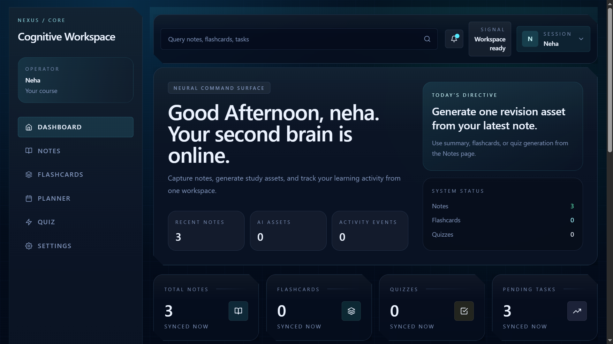
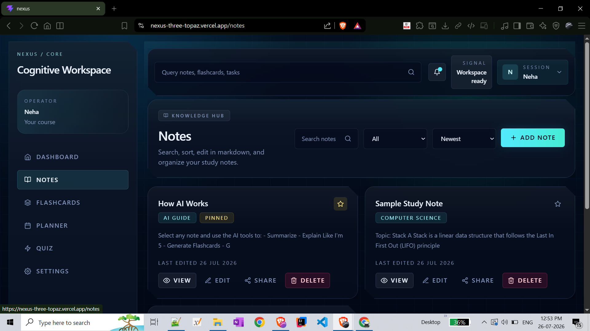
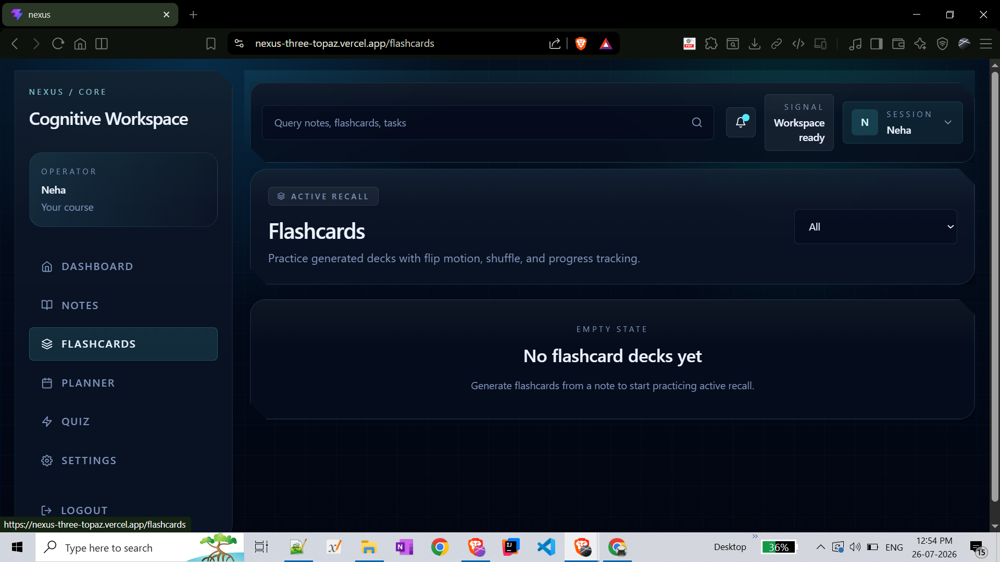
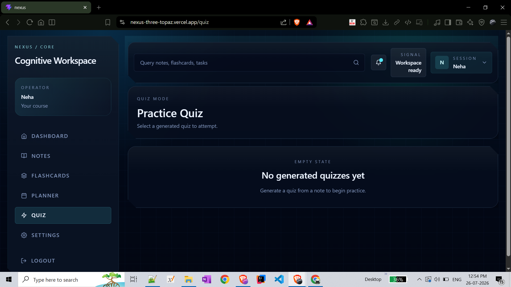
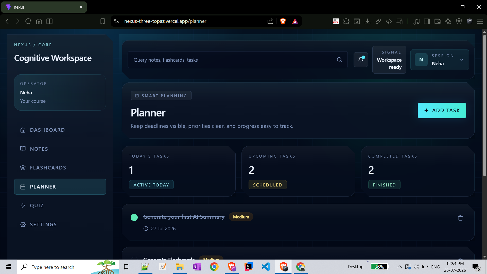

# Application Screenshots

This document provides a visual walkthrough of the NEXUS platform.

The screenshots below demonstrate the primary workflows and user experience across the application.

> **Note:** Screenshots may change slightly as the project continues to evolve.

---

# Application Flow

```
Landing Page
      │
      ▼
Authentication
      │
      ▼
Dashboard
      │
 ┌────┼────┬─────────┬──────────┐
 ▼    ▼    ▼         ▼          ▼
Notes Planner Flashcards Quiz Settings
      │
      ▼
AI Study Tools
```

---

# Landing Page

The landing page introduces the platform and provides users with access to authentication.

### Highlights

- Modern responsive interface
- Clear call-to-action
- Introduction to NEXUS
- Navigation to Login and Signup

<p align="center">


</p>

---

# User Authentication

The authentication module allows users to securely create an account and access their personalized workspace.

### Features

- User Registration
- Secure Login
- JWT Authentication
- Session Persistence

<p align="center">

| Login | Signup |
|-------|--------|
|  |  |

</p>

---

# Dashboard

The dashboard serves as the central workspace after authentication.

It provides a quick overview of the user's activity and study resources.

### Highlights

- Personalized Welcome
- Study Statistics
- Recent Activity
- Quick Navigation

<p align="center">



</p>

---

# Notes Workspace

The Notes module is the primary study environment.

Users can organize academic material efficiently while taking advantage of search and filtering capabilities.

### Highlights

- Create Notes
- Edit Notes
- Delete Notes
- Pin Important Notes
- Search
- Subject Filtering
- Sorting Options

<p align="center">



</p>

---

# AI Study Assistant

NEXUS transforms existing notes into intelligent study material.

Available AI actions include:

- Summarize
- Explain Concepts
- Extract Key Concepts
- Study Tips
- Mnemonics
- Revision Sheets
- Flashcards
- Practice Quiz

> **Note:** AI functionality requires a configured API provider.

<p align="center">


</p>

---

# Flashcards

The Flashcards module promotes active recall by converting notes into question-answer pairs.

### Highlights

- AI-generated flashcards
- Interactive review
- Personalized study material

<p align="center">



</p>

---

# Quiz Module

Automatically generated quizzes allow students to test their understanding of concepts.

### Highlights

- Multiple Choice Questions
- Score Calculation
- Answer Review
- Self Assessment

<p align="center">



</p>

---

# Study Planner

The Planner helps users organize daily academic tasks and monitor progress.

### Highlights

- Task Management
- Progress Tracking
- Daily Planning
- Completion Status

<p align="center">



</p>

---

# Responsive Design

NEXUS is designed to provide a consistent experience across different screen sizes.

Supported platforms include:

- Desktop
- Laptop
- Tablet
- Mobile Browser

<p align="center">


</p>

---

# Cloud Deployment

The application is deployed using modern cloud infrastructure.

```
Frontend
    │
    ▼
Vercel

Backend
    │
    ▼
Render

Database
    │
    ▼
MongoDB Atlas
```

The live deployment allows authenticated users to access their study workspace from anywhere with an internet connection.

---

# User Journey

A typical workflow within NEXUS follows this sequence:

```
Create Account
      │
      ▼
Login
      │
      ▼
Create Notes
      │
      ▼
Organize Content
      │
      ▼
Generate AI Study Material
      │
      ▼
Practice with Flashcards
      │
      ▼
Take Quizzes
      │
      ▼
Track Progress
```

---

# Screenshot Directory

The repository expects the following image structure:

```
docs/
└── images/
    ├── landing-page.png
    ├── login.png
    ├── signup.png
    ├── dashboard.png
    ├── notes.png
    ├── ai-tools.png
    ├── flashcards.png
    ├── quiz.png
    ├── planner.png
    └── responsive.png
```

Screenshots should be captured using the latest version of the application to ensure that the documentation accurately reflects the current user interface.